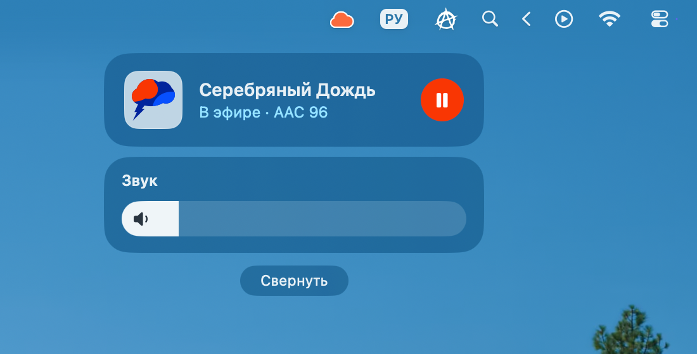
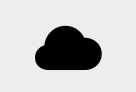
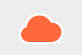
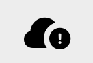
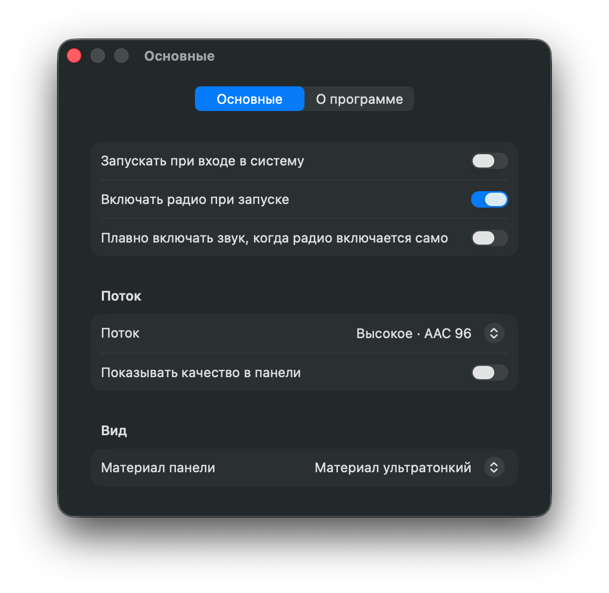
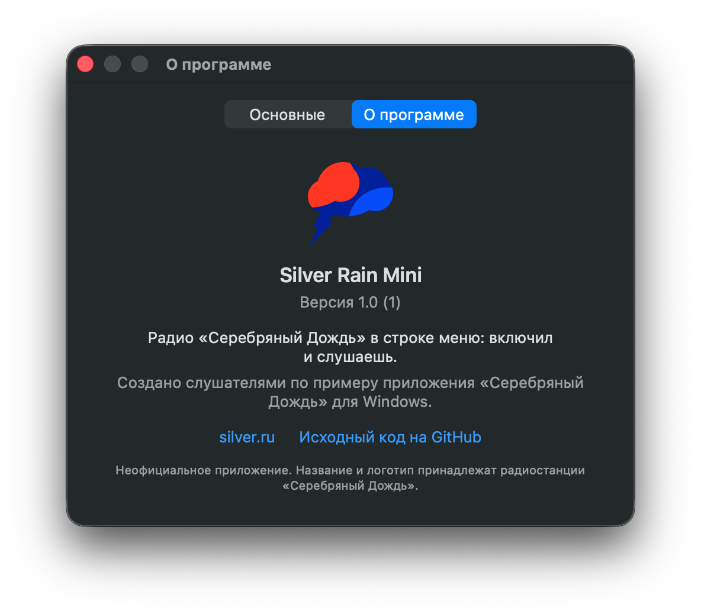

<p align="center">
  
</p>

<h1 align="center">Silver Rain Mini</h1>

<p align="center">
  Радио «Серебряный Дождь» в строке меню Mac: включил и слушаешь.
</p>

<p align="center">
  <a href="https://github.com/umkasanki/SilverRainMini/releases/latest">Скачать</a> ·
  <a href="#установка">Установка</a> ·
  <a href="#обратная-связь">Обратная связь</a>
</p>

---

## Что это и зачем

Silver Rain Mini — маленький приёмник радиостанции [«Серебряный Дождь»](https://silver.ru)
для macOS. У него нет окна и значка в Доке: облачко в строке меню, один клик — и в эфире.

У станции есть приложение для Windows, которое живёт в трее и всегда под рукой.
На Mac такого не было: приложение из App Store сделано для iPad, открывается обычным
окном и в строке меню не живёт. Я сделал для себя то, чего не хватало:
«включил и забыл», как на Windows, только по правилам macOS.

Приложение **некоммерческое**: бесплатное, без рекламы, без сбора данных, с открытым
исходным кодом. Оно **неофициальное** — к радиостанции отношения не имеет,
название и логотип принадлежат «Серебряному Дождю». Звук идёт напрямую с открытых
потоков станции, приложение лишь их проигрывает.

Сделано с расчётом на тех, кто управляет компьютером не только мышью: всё
доступно с клавиатуры и VoiceOver, кнопки крупные (не меньше 28 pt), ничего не
прячется под наведение и ничего не требует перетаскивания.

## Возможности

<p align="center">
  
</p>

**Панель в строке меню.** Клик по облачку открывает панель в стиле Пункта
управления macOS 26: логотип, состояние эфира, большая кнопка ▶︎/⏸ и громкость.
Закрывается кликом мимо, повторным кликом, `Esc` или кнопкой «Свернуть».
Правый клик по облачку — «Настройки…» и «Выйти».

**Облачко показывает, что происходит.**

| Тишина | Подключение | В эфире | Ошибка |
|:---:|:---:|:---:|:---:|
| <picture><source media="(prefers-color-scheme: dark)" srcset="docs/screenshots/menubar-idle-dark.png"></picture> | <picture><source media="(prefers-color-scheme: dark)" srcset="docs/screenshots/menubar-connecting-dark.png"></picture> | <picture><source media="(prefers-color-scheme: dark)" srcset="docs/screenshots/menubar-playing-dark.png"></picture> | <picture><source media="(prefers-color-scheme: dark)" srcset="docs/screenshots/menubar-error-dark.png"></picture> |

**Играет без присмотра.**
- Пропала сеть — радио ждёт и включается само, как только сеть вернулась.
- Mac уснул и проснулся — эфир продолжается, если играл до сна.
- Поток оборвался — повторы через 2, 5, 10 и дальше каждые 30 секунд, без ограничения.
- Основной сервер станции недоступен — переключается на запасной поток.

**Как в системе.**
- Плитка «Серебряный Дождь» в Пункте управления и на экране блокировки, с логотипом.
- Клавиша ▶︎⏸ (F8) на клавиатуре включает и ставит на паузу.
- Громкость своя, системную не трогает: перетаскивание, клик в точку, колёсико,
  стрелки, «без звука». Запоминается между запусками.

**Настройки.**

<p align="center">
  
</p>

- Запуск при входе в систему и включение радио при запуске.
- Плавное нарастание звука, когда радио включается само, — чтобы утром не будило громко.
- Качество потока: AAC 96 (по умолчанию), MP3 128 или экономный AAC 48 для слабой сети.
  Переключается на лету. Можно вписать свой адрес потока и проверить его кнопкой «Проверить».
- Вид панели: несколько материалов, от прозрачного стекла до плотного.

<p align="center">
  
</p>

Светлая и тёмная темы, «Уменьшить движение» и «Повысить контраст» — всё берётся из
системы. В покое приложение не тратит процессор, во время игры — около 1,5 % и
~40 МБ памяти.

## Установка

Нужна **macOS 26 (Tahoe)** или новее.

### Homebrew

```bash
brew tap umkasanki/tap
brew trust umkasanki/tap
brew install --cask silver-rain-mini
```

`brew trust` нужен один раз: Homebrew просит подтвердить сторонний tap. После
установки приложение сразу запускается из «Программ». Обновление — `brew upgrade`.

### DMG

1. Скачайте `SilverRainMini-<версия>.dmg` из
   [последнего релиза](https://github.com/umkasanki/SilverRainMini/releases/latest).
2. Откройте его и перетащите **Silver Rain Mini** в папку «Программы».
3. Первый запуск. Приложение подписано самоподписанным сертификатом и не
   нотаризовано в Apple (это платно), поэтому macOS один раз его остановит.
   Проще всего — одна команда в Терминале, и предупреждения не будет вовсе:
   ```bash
   xattr -dr com.apple.quarantine "/Applications/Silver Rain Mini.app"
   ```
   Без Терминала:
   - запустите приложение; в предупреждении нажмите **«Готово»**.
     Не «Переместить в Корзину»: эта кнопка удалит приложение, а разрешить его
     запуск будет уже нельзя;
   - откройте **Системные настройки → Конфиденциальность и безопасность**,
     внизу в разделе «Безопасность» у строки про Silver Rain Mini нажмите
     **«Всё равно открыть»** (строка видна около часа после предупреждения).

Обновление — та же установка поверх старой версии. Все релизы подписаны одним
сертификатом, поэтому macOS узнаёт приложение: настройки, автозагрузка и
выданные разрешения сохраняются.

## Сборка из исходников

Нужны Xcode 26 и [XcodeGen](https://github.com/yonaskolb/XcodeGen) (`brew install xcodegen`).

```bash
git clone https://github.com/umkasanki/SilverRainMini.git
cd SilverRainMini
tools/setup-signing.sh   # один раз: свой сертификат, чтобы разрешения не слетали между сборками
make install             # собрать, установить в /Applications
```

| Команда | Что делает |
|---|---|
| `make app` | собирает `build/Silver Rain Mini.app` |
| `make run` | собирает и запускает |
| `make install` | собирает и ставит в `/Applications` |
| `make test` | автотесты |
| `make dmg` | `build/SilverRainMini-<версия>.dmg` и `.zip` |

Без `tools/setup-signing.sh` сборка тоже работает, но подписывается ad-hoc: каждая
новая сборка для macOS — другое приложение, и автозагрузку придётся включать заново.

Как приложение устроено и почему так — в [PLAN.md](PLAN.md); что именно оно делает
и как это проверяется — в [SPEC.md](SPEC.md).

### Выпуск релиза

Релизы собирает [GitHub Actions](.github/workflows/release.yml) по тегу:

```bash
git tag v1.0.0 && git push origin v1.0.0
```

Экшен прогоняет тесты, собирает и подписывает приложение, публикует релиз с `.dmg`
и `.zip` и обновляет cask в [umkasanki/homebrew-tap](https://github.com/umkasanki/homebrew-tap).

Один раз нужны секреты репозитория:
- `SIGNING_P12_BASE64`, `SIGNING_P12_PASSWORD` — тот же сертификат, что и у локальных
  сборок: `tools/setup-signing.sh --secrets`. Без них релиз не выпускается — иначе
  обновление сбросило бы пользователям разрешения.
- `TAP_TOKEN` — fine-grained токен с правом **Contents: write** только на `homebrew-tap`.
- `TAP_DEPLOY_KEY` — запасной путь: закрытая часть ключа развёртывания с правом записи
  в `homebrew-tap`. Используется, если токена нет, и не истекает.

  Без обоих релиз выходит, а cask нужно обновить вручную по
  [шаблону](packaging/homebrew/silver-rain-mini.rb).

## Обратная связь

Нашли ошибку, не хватает чего-то или есть идея — создайте
[issue](https://github.com/umkasanki/SilverRainMini/issues) в этом репозитории
или напишите на [umkasanki@gmail.com](mailto:umkasanki@gmail.com).
Буду рад любым замечаниям и предложениям.
